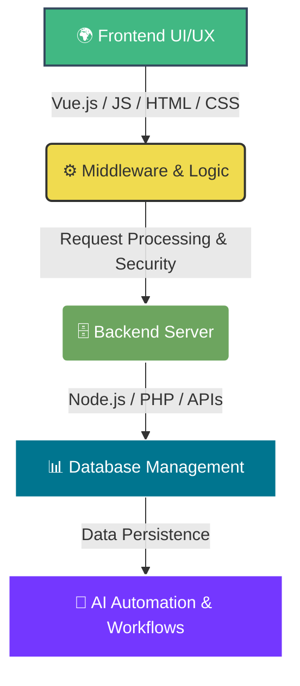

# Hi there, I'm Irene! 👋 
> *“To love God is the key that opens your door. Coding must be my life without any barriers that can hold me back. NEVER GIVE UP! God is perfect.”* ✨

---

## 🗺️ Full-Stack Development Roadmap & Architecture Flow

---

### 🎮 Featured Project Showcase
Here are some highlights from my **34 repositories**:

* 🏠 **[Demu's House Management System](https://github.com)** — Full-featured real estate logic and property management platform.
* 💼 **[Uwishema Professional Hub](https://github.com)** — Full-stack personal architectural node engine.
* 🕹️ **[Whack-a-Mole Game](https://github.com)** — Interactive arcade game built from scratch using Vue.js reactivity.
* 🚀 **[MyGame Engine](https://github.com)** — Custom client-side rendering browser engine setup.

---

### 🛠️ Tech Stack Matrix

<table>
  <tr>
    <td valign="top" width="33%">
      <h4 align="center">💻 Frontend</h4>
      

        <code>HTML5</code>  
        <code>CSS3 / Positioning</code>  
        <code>JavaScript</code>  
        <code>Vue.js</code>
      

    </td>
    <td valign="top" width="33%">
      <h4 align="center">⚙️ Backend & Logic</h4>
      

        <code>Node.js</code>  
        <code>PHP</code>  
        <code>Middleware Systems</code>  
        <code>REST APIs</code>
      

    </td>
    <td valign="top" width="33%">
      <h4 align="center">🗄️ Infrastructure</h4>
      

        <code>Database Management</code>  
        <code>AI Automation</code>  
        <code>Git Versioning</code>
      

    </td>
  </tr>
</table>

---

### 📊 Real-time Performance Metrics

  
  

---

### 📫 Connect With Me
* 🌐 **Live Portfolio:** [ireneuwishemaprog.netlify.app](https://ireneuwishemaprog.netlify.app/)
* 📧 **Public Email:** [ireneuwishema@gmail.com](mailto:ireneuwishema@gmail.com)
* 🦈 **GitHub Badges:** Earned `YOLO` & `Pull Shark` architectures.
